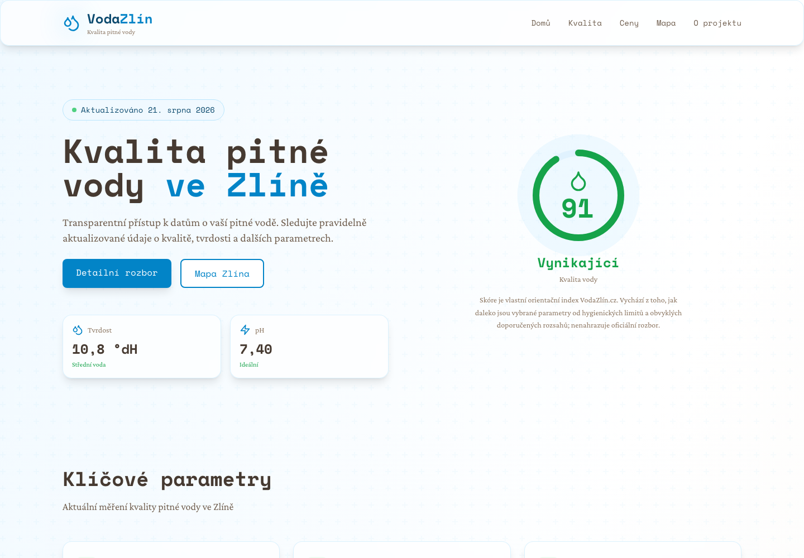
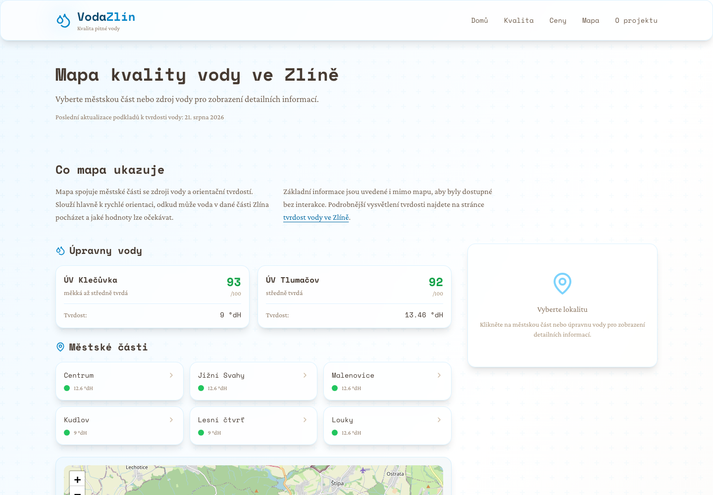
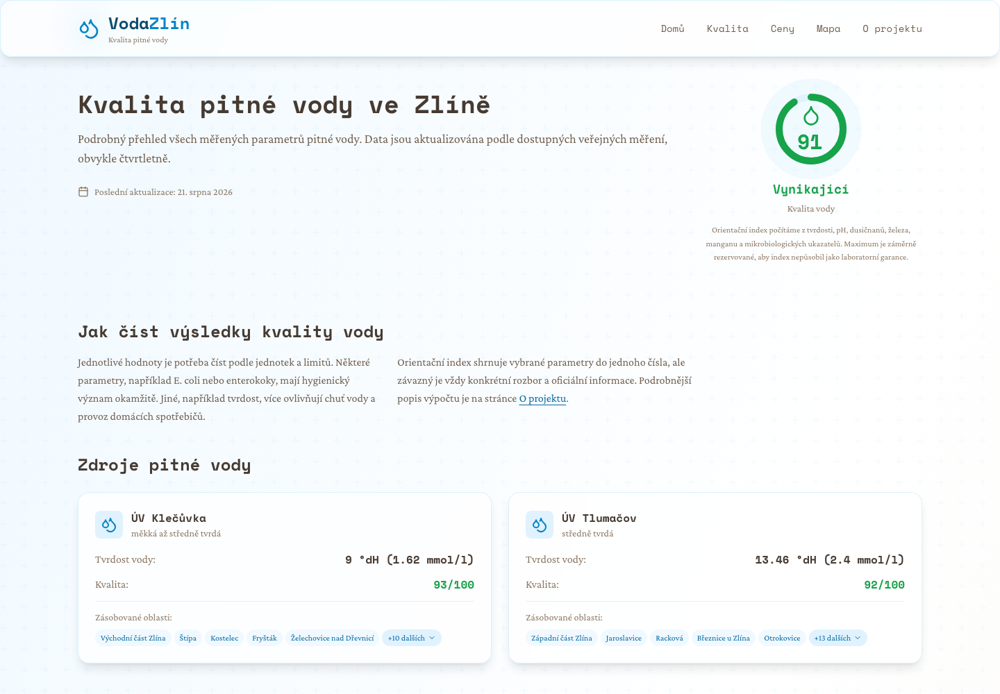

# VodaZlín.cz

[](https://github.com/msuranek/vodazlin/actions/workflows/tests.yml)
[](https://github.com/msuranek/vodazlin/actions/workflows/static-dist.yml)
[](https://vodazlin.cz)

Přehled kvality, tvrdosti a ceny pitné vody ve Zlíně postavený nad veřejně dostupnými daty.

**Živý web: [vodazlin.cz](https://vodazlin.cz)**

## Ukázky

### Úvodní přehled



### Mapa zásobovaných oblastí



### Detail kvality vody



## Zdroje dat

Primárním zdrojem je [Vodárna Zlín a.s.](https://www.vodarnazlin.cz), tedy místní provozovatel vodovodu. Projekt automaticky zpracovává:

- zveřejněný ceník vodného a stočného;
- veřejný PDF podklad s hodnotami tvrdosti vody;
- datum a stav poslední úspěšné aktualizace.

Ostatní chemické a mikrobiologické hodnoty na webu slouží jako orientační základ pro vysvětlení jednotlivých ukazatelů. Nejde o živý laboratorní monitoring ani o oficiální službu Vodárny Zlín, hygienické stanice nebo jiné instituce. Orientační skóre kvality je pouze vlastní souhrnný ukazatel webu.

## Zpracování dat

```text
Vodárna Zlín → HTML/PDF scraper → validace a transformace → JSON → Next.js build → statický web
```

Workflow se spouští při pushi do `master`, ručně přes `workflow_dispatch` a automaticky první den v měsíci. Skript stáhne ceník a podklady k tvrdosti vody, zkontroluje očekávaný formát a rozsahy hodnot, aktualizuje JSON snapshoty a vytvoří statický export ve větvi `dist`.

Pokud externí zdroj změní strukturu nebo není dostupný, aktualizace skončí chybou a existující statický web zůstane beze změny.

## Lokální spuštění

```bash
cd frontend
npm ci
npm run dev
```

Vývojový server běží na `http://localhost:3000`.

Statický build se sestaví a naservíruje takto:

```bash
cd frontend
npm run build
npm run start
```

Výstup je ve `frontend/out/`, lokální statický server běží na `http://localhost:8080`.

Docker image servíruje stejný statický export přes nginx:

```bash
cd frontend
docker compose up --build
```

## Aktualizace dat

```bash
cd frontend
npm run update-data
```

Data se stahují z [Vodárny Zlín](https://www.vodarnazlin.cz) a ukládají do `frontend/data/`. Síťová aktualizace je záměrně oddělená od běžného lokálního buildu, který lze sestavit z posledního uloženého snapshotu.

## Testy

```bash
cd frontend
npm test
```

Testy používají uložené fixtures zdrojového HTML a textu extrahovaného z PDF. Pokrývají parsování cen a tvrdosti, převod jednotek, kontrolu nepravděpodobných hodnot a výpočet orientačního skóre kvality.

## Technologie

- **Next.js 14** (App Router, TypeScript, statický export)
- **Tailwind CSS**
- **Leaflet** (interaktivní mapa)
- **Node.js scraper** (`pdf-parse`, Fetch API)
- **GitHub Actions** (testy, měsíční aktualizace a publikace)

## Struktura

```text
frontend/
├── app/                     # Stránky a statický export Next.js
├── components/              # Karty, skóre, mapa a layout
├── data/                    # Aktuální JSON snapshoty (generované)
├── lib/                     # Načítání dat a utility
├── scripts/
│   ├── data-parsers.mjs     # Testovatelné parsery a transformace
│   └── update-data.mjs      # Stažení zdrojů a zápis snapshotů
└── tests/                   # Regresní testy a fixtures
```

## Licence

MIT
